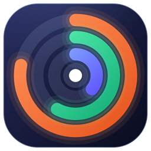
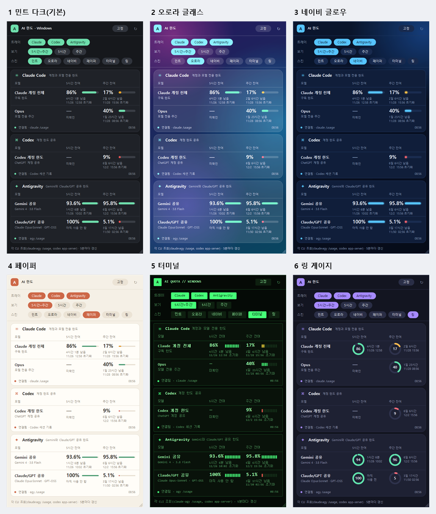

# AI Quota Tray for Windows

[한국어](README.md) | **English**

A small Windows tray app that shows the remaining **5-hour and weekly quota** of **Claude Code, Codex and Antigravity** at a glance.
Click the tray icon to open the panel; the number on the icon is the lowest remaining percentage among the services you have switched on.

> Unofficial. It reads the output of each tool's own CLI. This app reads no tokens and sends nothing anywhere.

## Features
- **Three services in one place** — remaining 5-hour / weekly quota, time until reset, and Codex reset coupons
- **6 skins** — Mint · Aurora · Navy · Paper · Terminal · Ring. The tray icon changes with the skin ([icon sheet](docs/tray-icons.png))
- **A freely placed panel** — drag an empty area to move it, resize from any edge or corner (Ctrl + mouse wheel also works), "pin" it to keep it on screen, multi-monitor aware
- **Choose what to show** — a switched-off service hides its card and is not queried at all
- Lightweight: refreshes every 5 minutes (immediately when you open the panel) and runs only in the tray, with no window

## Install
1. Download this repository and unzip it (Code → Download ZIP).
2. Double-click `install.cmd`. It asks whether to start with Windows and creates an "AI 한도" shortcut on the desktop.
   (If `AIQuotaTray.exe` is missing, it is built from source automatically with the compiler that ships with Windows.)
3. Run **AI 한도** from the desktop.
4. The first time, the icon lands in the hidden overflow area (^). Open Settings → Personalization → Taskbar → Other system tray icons and turn on **AIQuotaTray**.

Uninstall: `powershell -ExecutionPolicy Bypass -File install.ps1 -Remove`

## Requirements
- Windows 10/11 (Windows PowerShell 5.1 and .NET Framework 4 are built in)
- Install and sign in to whichever services you want to see: `claude` (Claude Code CLI), `agy` (Antigravity CLI), Codex (the desktop app, or the CLI installed with `npm i -g @openai/codex`)
  - Services that are missing show as "unknown"; the rest keep working.

## Where the numbers come from (transparency)
This app **does not read tokens or credential files.** It runs each program under its own sign-in and interprets the output.

| Service | Method |
|---|---|
| Claude Code | output of `claude -p "/usage"` |
| Antigravity | output of `agy -p "/usage"` |
| Codex | starts a local `app-server` (loopback WebSocket) from `codex.exe` of the Codex desktop app or npm CLI and sends `account/rateLimits/read` (`codex_usage.ps1`) |

The app itself sends no data anywhere. (What each CLI exchanges with its own servers is that program's own behavior.)
Settings are stored in `%USERPROFILE%\.ai-quota-tray\settings.json`.

## Good to know
- This is an **unofficial tool**. The methods above are not interfaces the programs officially promise, so after an update a value may disappear or its format may change.
- The executable is unsigned, so Windows may show a SmartScreen warning the first time. The full source is public — please read it before you run it.
- Claude, Codex, Antigravity and their names are trademarks of their respective companies. This project is neither affiliated with nor sponsored by them.

## Files
| File | Role |
|---|---|
| `AIQuotaTray.ps1` | The app itself (tray, panel, skins, queries). After editing, just restart the app |
| `AIQuotaTray.cs` | Launcher (a tiny exe that hosts the PowerShell engine in-process) |
| `codex_usage.ps1` | Helper that queries Codex quota |
| `install.cmd` / `install.ps1` | Create / refresh / remove shortcuts, build the exe when needed |
| `ai_quota.ico` / `make_icon.ps1` | App icon (from the outside in: Claude, Codex and Antigravity quota gauges) and the script that draws it |

Developer options: `AIQuotaTray.ps1 -Probe` (print values only), `-Shot out.png -Demo -Skin terminal` (save a screenshot), `-IconSheet out.png` (tray icon sheet).
To add a skin, add its colors, font and bar style to the `$Skins` table in `AIQuotaTray.ps1`.

## Credits
The idea comes from the macOS app [ARSEN AI Quota](https://github.com/tti9494/arsen-ai-quota) (MIT). The code in this repository was written from scratch for Windows.

## License
[MIT](LICENSE)
