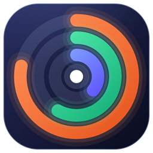
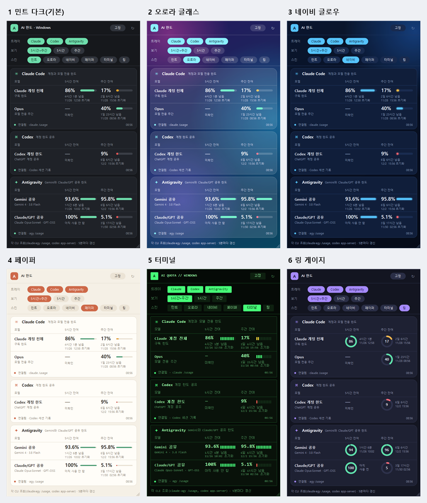

# AI Quota Tray for Windows

작업표시줄 트레이에서 **Claude Code · Codex · Antigravity** 한도 잔여율(5시간·주간)을 한눈에 보여주는 작은 Windows 앱입니다.
아이콘을 누르면 패널이 열리고, 아이콘 숫자는 켜 둔 항목 중 가장 낮은 잔여율입니다.

> A small Windows tray app that shows the remaining 5-hour / weekly quota of Claude Code, Codex and Antigravity.
> Unofficial; reads the output of each tool's own CLI. No tokens are read, nothing is sent anywhere by this app.

## 주요 기능
- **세 서비스 한도 표시** — 5시간·주간 잔여율, 초기화까지 남은 시간, Codex 초기화 쿠폰
- **스킨 6종** — 민트 · 오로라 · 네이비 · 페이퍼 · 터미널 · 링. 시계 옆 아이콘도 스킨에 맞춰 바뀜 ([아이콘 모음](docs/tray-icons.png))
- **자유로운 패널** — 빈 곳을 끌어 이동, 네 변·네 모서리로 크기 조절(Ctrl+휠도 가능), "고정"으로 계속 띄워 두기, 여러 모니터 지원
- **표시 항목 선택** — 끈 항목은 카드도 숨기고 조회도 건너뜀
- 가볍게 5분마다 갱신(패널을 열면 즉시), 창 없이 트레이에서만 동작

## 설치
1. 이 저장소를 내려받아 압축을 풉니다(Code → Download ZIP).
2. `install.cmd`를 더블클릭합니다. 시작 프로그램 등록 여부를 묻고, 바탕화면에 "AI 한도" 바로가기를 만듭니다.
   (실행 파일 `AIQuotaTray.exe`가 없으면 Windows에 기본 포함된 컴파일러로 소스에서 자동으로 만듭니다.)
3. 바탕화면의 **AI 한도**를 실행합니다.
4. 처음에는 아이콘이 숨김 영역(^)에 들어가니, 설정 → 개인 설정 → 작업 표시줄 → 기타 시스템 트레이 아이콘에서 **AIQuotaTray**를 켜 두세요.

제거: `powershell -ExecutionPolicy Bypass -File install.ps1 -Remove`

## 필요한 것
- Windows 10/11 (Windows PowerShell 5.1과 .NET Framework 4는 기본 포함)
- 보고 싶은 항목만큼 설치·로그인: `claude`(Claude Code CLI), `agy`(Antigravity CLI), Codex 데스크톱 앱
  - 없는 항목은 "미확인"으로 표시되고 나머지는 정상 동작합니다.

## 한도를 어디서 읽나 (투명성)
이 앱은 **토큰이나 인증 파일을 읽지 않습니다.** 각 프로그램을 자기 로그인으로 실행해서 그 출력을 해석합니다.

| 항목 | 방법 |
|---|---|
| Claude Code | `claude -p "/usage"` 출력 |
| Antigravity | `agy -p "/usage"` 출력 |
| Codex | Codex 앱의 로컬 `app-server`(루프백 WebSocket)에 `account/rateLimits/read` 요청 (`codex_usage.ps1`) |

이 앱 자체는 외부로 어떤 데이터도 보내지 않습니다. (각 CLI가 자기 서버와 통신하는 것은 그 프로그램의 동작입니다.)
설정은 `%USERPROFILE%\.ai-quota-tray\settings.json`에 저장됩니다.

## 알아둘 점
- **비공식 도구**입니다. 위 방식은 각 프로그램이 공식적으로 약속한 인터페이스가 아니어서, 프로그램이 업데이트되면 값이 안 나오거나 형식이 바뀔 수 있습니다.
- 서명되지 않은 실행 파일이라 Windows가 처음에 경고(SmartScreen)를 띄울 수 있습니다. 소스가 전부 공개되어 있으니 직접 확인하고 쓰세요.
- Claude, Codex, Antigravity 및 각 이름은 해당 회사의 상표입니다. 이 프로젝트는 그들과 제휴하거나 후원받지 않았습니다.

## 파일 구성
| 파일 | 역할 |
|---|---|
| `AIQuotaTray.ps1` | 앱 본체(트레이·패널·스킨·조회). 수정 후 앱만 다시 실행하면 반영 |
| `AIQuotaTray.cs` | 실행기(PowerShell 엔진을 프로세스 안에서 구동하는 작은 exe) |
| `codex_usage.ps1` | Codex 한도 조회 도우미 |
| `install.cmd` / `install.ps1` | 바로가기 설치·갱신·제거, 필요 시 exe 빌드 |
| `ai_quota.ico` / `make_icon.ps1` | 앱 아이콘(바깥부터 Claude·Codex·Antigravity 한도 게이지)과 그 생성 스크립트 |

개발용 옵션: `AIQuotaTray.ps1 -Probe`(값만 출력), `-Shot out.png -Demo -Skin terminal`(화면 이미지 저장), `-IconSheet out.png`(트레이 아이콘 모음).
스킨은 `AIQuotaTray.ps1`의 `$Skins` 표에 색·글꼴·막대 모양을 추가하면 늘릴 수 있습니다.

## 감사
macOS용 [ARSEN AI Quota](https://github.com/tti9494/arsen-ai-quota)(MIT)에서 아이디어를 얻었습니다. 이 저장소의 코드는 Windows용으로 새로 작성했습니다.

## 라이선스
[MIT](LICENSE)
